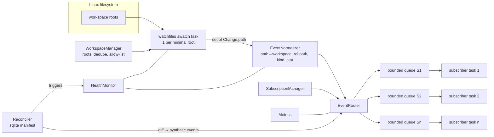

# FileMonitor — Technical Specification

**Component:** `partner_bot.file_monitor`
**Target release:** v0.1.0
**Status:** Design approved for build. Phase-1 execution plan lives in [`BUILD-PLAN.md`](../../BUILD-PLAN.md). Nothing in this document has been implemented yet.
**Owner:** Wes Bramwell (A.I Partner PTY LTD) · **Author:** Marty (Executive Assistant)
**Date:** 2026-11-21

---

## 1. Executive summary

Partner Bot runs multiple autonomous agents on a single user-owned Linux VPS. Those agents write,
rename and delete files across several project workspaces at once. The platform needs one shared,
cheap, honest filesystem-change signal that any component (dashboard, audit log, agent supervisor,
Git diff view) can subscribe to without each one opening its own OS watchers.

`FileMonitor` is that component: an embeddable Python package, one instance per runtime, that

- watches the **union** of registered workspace roots with **one** `inotify` instance and exactly
  one kernel watch per directory (measured: 241 directories → 241 watches, 1 instance);
- normalises every backend notification into one immutable event contract and fans it out to
  N subscribers with **bounded, per-subscriber queues**;
- states plainly what it cannot see (rename pairing, kernel queue overflow, write timestamps,
  *which* agent wrote a file) and closes those gaps with **metadata reconciliation** rather than
  pretending the event stream is complete.

The v0.1 backend is [`watchfiles` 1.3.0](https://pypi.org/project/watchfiles/) (MIT, wraps the Rust
`notify` crate). It is the throughput-correct choice and its abstraction is *known* to be
insufficient for health reporting — that insufficiency is designed around in §5.3 and §9, not
wished away. The backend is behind a narrow adapter interface so a native or watchdog backend can
be added later without touching the public API (§20, ADR-002).

Measured on this VPS (241 dirs / 2 000 files): 0.067 s to register all watches, 40 ms
end-to-end event latency, +520 KB RSS, 0.01 s CPU over 3 s idle, zero watches left after stop.
Method and raw output in §3.4.

---

## 2. Goals and non-goals

### 2.1 Goals (v0.1)

| # | Goal | Acceptance |
|---|---|---|
| G1 | One shared monitor per runtime, many subscribers | Two subscriptions on one root create one kernel watch set (asserted) |
| G2 | Low idle cost on a 2 vCPU / 2 GB box | ≤1 % of one core idle, RSS growth ≤5 MB for 2 000 directories |
| G3 | Near-real-time delivery | p50 ≤150 ms, p95 ≤500 ms from filesystem write to subscriber delivery, measured by the benchmark harness |
| G4 | Bounded memory under bursts | No unbounded growth; saturation produces an explicit gap signal, never silent loss |
| G5 | Honest health | Four health states driven by measured divergence, not by "no exception yet" |
| G6 | Isolated workspaces | A subscription can only observe paths inside a registered workspace root |
| G7 | Testable without the platform | Full test suite runs with `pytest` and `tmp_path` only |

### 2.2 Non-goals (v0.1)

- **No content diffing, no hashing of file contents, no historical versions.** Lines-added/removed
  belongs to a separate Git-backed module (§5.4).
- **No identification of which agent wrote a file.** Filesystem events cannot do this; only
  instrumentation in the agent runner can (§14.3).
- **No network transport, no Redis/Kafka/Celery, no daemon.** Embedded module only (ADR-003).
- **No Windows/macOS support commitment.** Linux is the target; the code must not crash elsewhere
  but is not tested there.
- **No fanotify/eBPF backend, no per-file watches, no recursive watch fan-out per subscriber.**
- **No UI.** The dashboard consumes this module in a later phase.
- **No exactly-once delivery claim.** See §9.3.

---

## 3. Verified technical research

### 3.1 Mechanisms

**`inotify` (Linux, since 2.6.13).** `inotify_init1()` returns an fd; `inotify_add_watch(fd, path,
mask)` adds a watch on one *directory or file*, and events for entries inside a watched directory
arrive with `(name, mask, cookie)` — `cookie` pairs `IN_MOVED_FROM`/`IN_MOVED_TO` for renames.
Recursion is **not** a kernel feature: a recursive watcher must add a watch for every directory and
add new ones as directories are created. Limits per real UID:
`fs.inotify.max_user_watches`, `fs.inotify.max_user_instances`, and per-instance
`fs.inotify.max_queued_events`. The man page is explicit that when the queue overflows, *"events in
excess of this limit are dropped, but an `IN_Q_OVERFLOW` event is always generated"*, and that a
robust application "should allow for the fact that bugs in the monitoring logic or races … may
leave the cache inconsistent" and "do some consistency checking". <https://man7.org/linux/man-pages/man7/inotify.7.html>

**`watchfiles` 1.3.0.** Python API over the Rust `notify` crate, one background Rust thread per
watch call. `watch()/awatch()` yield a **set** of `(Change, path)`; `Change` is only
`added | modified | deleted` (verified in the installed 1.3.0 source). Tuning: `debounce`
(max ms to keep grouping, default 1600), `step` (ms of quiet before yielding, default 50),
`rust_timeout`, `force_polling`, `poll_delay_ms`, `recursive`, `ignore_permission_denied`.
Public API is exactly `watch, awatch, run_process, arun_process, Change, BaseFilter, DefaultFilter,
PythonFilter, VERSION`. <https://watchfiles.helpmanual.io/api/watch/>

**`watchdog` 7.1.0.** Pure-Python observers with a native per-OS emitter; the Linux emitter speaks
`inotify` directly and surfaces richer semantics (`FileMovedEvent` with src/dest paired by cookie,
`FileClosedEvent` on `IN_CLOSE_WRITE`, per-event objects with `is_directory`). Thread per observer;
one Python object per event. Apache-2.0, requires Python ≥3.11, optional `watchmedo` extra pulls
PyYAML. <https://pypi.org/project/watchdog/>

**`notify` (Rust, 8.2.2).** Documented known problems that matter here: network filesystems such as
NFS "may not emit any events"; pseudo-filesystems like `/proc` and `/sys` do not emit change events;
and for very large amounts of watched files "notify may fail to receive all events". It recommends
raising the inotify limits and mentions `PollWatcher` as the alternative. <https://docs.rs/notify/latest/notify/>

### 3.2 Comparison

| Criterion | inotify raw (ctypes) | `watchfiles` 1.3.0 | `watchdog` 7.1.0 | Polling |
|---|---|---|---|---|
| Mechanism | epoll on inotify fd | Rust `notify` → inotify | native inotify emitter | `os.scandir` diff |
| Idle CPU | ~0 | ~0 (blocking read in Rust thread) | ~0 | proportional to tree size / interval |
| Event latency | µs (kernel) | ms (debounce/step) | ms (debounce) | ≥ poll interval |
| Recursive | manual per-dir | built in, dynamic add works | built in, Python-side `os.walk` | n/a |
| Rename pairing | yes (`cookie`) | **no — reported as delete+create** (measured) | **yes** (`FileMovedEvent`) | inferred from inode |
| Overflow visibility | `IN_Q_OVERFLOW` event | **not exposed to Python** | `IN_Q_OVERFLOW` surfaced as emitter event | n/a |
| Read/close detail | `IN_CLOSE_WRITE` etc. | no | yes | no |
| Registration cost | 1 syscall/dir, fastest | fast (measured 3 600 dirs/s) | Python loop per dir, slower at 100 k+ | one full walk |
| Memory per event | zero (struct read) | zero in Python until the set is built | one Python object per event | n/a |
| Threads | 0 (your loop) | 1 Rust thread | 1 Python thread per observer | 0 |
| Failure signalling | exceptions on syscalls | `OSError` from the watch call; **not** from overflow | `OSError`/emitter errors, `LOG` sink | exceptions |
| Maintenance | kernel API | active, 1.3.0, used by uvicorn | active, 7.1.0 | n/a |
| Dependency weight | none (but you own the syscalls) | `anyio` only | none (Optional PyYAML) | none |
| Licence | n/a | MIT | Apache-2.0 | n/a |

### 3.3 Recommendation

**Use `watchfiles` 1.3.0 as the single v0.1 backend.**

Rationale: (a) it is the only option that both stays async-native and pushes coalescing into Rust,
which is what keeps a burst of 10 000 build-output writes from becoming 10 000 Python objects on a
2 vCPU box; (b) its dependency surface is one package (`anyio`); (c) binaries exist for the common
architectures, so users are not asked to install a Rust toolchain.

Accepted cost, stated openly:

- **Rename is reported as delete+create.** Measured: renaming `f0005.txt` → `moved.txt` produced
  `[added moved.txt, deleted f0005.txt]`; renaming a directory produced
  `[added d002renamed, deleted d002]`. v0.1 therefore never emits a RENAME kind from the live stream;
  rename pairing is only available from reconciliation (same inode, new path) — and even that is
  unavailable for trees whose manifest is disabled.
- **Queue overflow is invisible.** `Change` has three members and the raw Rust event is not exported,
  so `IN_Q_OVERFLOW` (and `notify`'s own lost-event cases) cannot be observed from Python. v0.1
  therefore **cannot claim event completeness**, ever. Mitigation: mandatory reconciliation the
  moment divergence is suspected (§9.2), and health that reports `DEGRADED` on any unexplained gap.
- **Permission-denied during recursive registration is silently skipped by default.** We pass
  `ignore_permission_denied=False` so it surfaces as an error, and record the failing root.

Rejected: raw `inotify` via `ctypes` (owns syscall correctness — the brief's Rule 7 forbids
reimplementing proven mechanisms); `watchdog` (richer semantics, but one Python object per event and
a Python-side recursive walk — the wrong trade on a 2 vCPU burst box); polling (wrong latency, wrong
CPU profile).

**Revisit trigger (ADR-002):** if the product grows a requirement for rename pairing in the live
stream or for explicit overflow reporting, add a `WatchdogBackend` — do not fork the public API.

### 3.4 Verified probe evidence

Command: `/tmp/fmprobe/bin/python /tmp/fmprobe/probe.py` (Ubuntu kernel 7.0.0-43, CPython 3.11.17,
watchfiles 1.3.0, tree = 241 directories / 2 000 files, `debounce=50`, `step=20`).

| Measurement | Result |
|---|---|
| Kernel limits on this host | `max_user_watches=63655`, `max_user_instances=128`, `max_queued_events=16384` |
| Registration time, 241 dirs | **0.067 s** |
| Kernel watches created | **241** (exactly 1 per directory), `instances=1` |
| RSS delta after registration | **+520 KB** |
| Modify → event latency | 0.040 s |
| Create → event latency | 0.040 s |
| Rename file | `added moved.txt`, `deleted f0005.txt` — **no rename kind** |
| Rename directory | `added d002renamed`, `deleted d002` |
| Atomic save (`write .tmp` + `os.replace`) | `added f0015.tmp`, `added f0015.txt`, `deleted f0015.tmp` (3 events) |
| `mkdir -p fresh/inner` + write `deep.txt` immediately | `added /fresh`, `modified /fresh/inner/deep.txt` — **the `added /fresh/inner` event is lost** |
| Second write inside that new directory, 1 s later | delivered (`added /fresh/inner/second.txt`) — dynamic registration works |
| `rm -rf` of a 5-dir / 50-file subtree | 56 delete events in one batch |
| Idle 3 s | 0.01 s CPU, RSS delta 0 |
| After `stop_event` | `instances=0, watches=0` — clean teardown |

**Extrapolations (estimate, not measured):** at the observed 3 600 dirs/s registration rate, 20 000
directories ≈ 5.5 s and 100 000 ≈ 28 s of startup registration. Watch memory per directory is
*kernel* memory we did not measure — treat as unknown until the phase-3 benchmark harness records
`/proc/meminfo`'s `SReclaimable`/slab delta across a registration of 100 000 watches.

**Unverified, with the test that settles it:** behaviour when `max_user_watches` is exhausted
(expectation: `OSError: [Errno 28] No space left on device` from `awatch` registration, possibly
*after* partial registration). Settling test: on a disposable user `ulimit`-independent box, set
`fs.inotify.max_user_watches=100`, request 241 dirs, assert the exception type and that
`FileMonitor.health()` reports `UNAVAILABLE` and that no partial watch set leaks
(`/proc/<pid>/fdinfo`).

---

## 4. Architecture

### 4.1 Component diagram



### 4.2 Component responsibilities

| Component | Owns | Must not |
|---|---|---|
| `WorkspaceManager` | id → root path mapping, path normalisation, root dedupe (minimal disjoint set), allow-list of roots | touch the backend |
| `backend.WatchfilesBackend` | lifecycle of `awatch` tasks, error mapping, per-root start/stop | know about workspaces or subscribers |
| `EventNormalizer` | map raw `(Change, path)` → `FileEvent`; `stat()` enrichment policy; path→workspace resolution incl. overlapping roots | route events |
| `EventRouter` | per-subscription queues, filtering, coalescing window, gap semantics, ordering | call user code inline |
| `SubscriptionManager` | subscription ids, lifecycle, capacity accounting | decide event semantics |
| `Reconciler` | sqlite manifest, scan, diff, synthesise events, schedule | block the ingest loop |
| `HealthMonitor` | state machine `HEALTHY/DEGRADED/RECONCILE_REQUIRED/UNAVAILABLE` | guess from exceptions alone |
| `Metrics` | counters/gauges as plain dataclass fields | own an exporter |
| `manager.FileMonitor` | public façade + lifecycle order | leak internal objects |

### 4.3 Component count critique

The brief's sketch contained `MonitoringBackend → WatchfilesBackend + PollingBackend`. v0.1 keeps
**only** the backend protocol plus one implementation: a second implementation with no caller is
dead weight. `SubscriptionManager` is a 60-line class inside `manager` rather than a module — it has
no independent lifecycle. `EventNormalizer` and `EventRouter` stay separate because one is pure
(unit-testable without a backend) and the other owns concurrency.

---

## 5. Event model

### 5.1 Contract

```python
from dataclasses import dataclass, field
from enum import StrEnum

class EventKind(StrEnum):
    CREATED = "created"
    MODIFIED = "modified"
    DELETED = "deleted"
    RENAMED = "renamed"          # reconciliation only in v0.1 (ADR-002)
    DIR_CREATED = "dir_created"
    DIR_DELETED = "dir_deleted"
    GAP = "gap"                  # events were dropped/coalesced for this subscriber between seq_a and seq_b
    RESYNC_REQUIRED = "resync_required"   # treat prior state as untrusted
    MONITOR_ERROR = "monitor_error"       # backend/registration failure, carries reason

@dataclass(frozen=True, slots=True)
class FileEvent:
    kind: EventKind
    workspace_id: str
    rel_path: str               # POSIX-style, relative to workspace root, never absolute
    observed_at: float          # time.monotonic() at normalisation, NOT file write time
    seq: int                    # monotonic per FileMonitor instance
    is_dir: bool = False
    size: int | None = None     # only when a stat succeeded and policy allows
    src_rel_path: str | None = None   # RENAMED only
    detail: str | None = None         # GAP/MONITOR_ERROR reason
```

Rules:

- `rel_path` is always relative and POSIX-separated. Absolute paths never leave the module; the
  dashboard must not be able to learn a host path from an event.
- `observed_at` is when **we** saw it. It is not a file modification time and must never be
  presented as one. `mtime_ns` may be added as `detail` only from an explicit `stat()`.
- `size` is populated only for `CREATED`/`MODIFIED`/`DELETED` where the policy allows a `stat()`
  (§8.3), and is `None` when the file vanished or the stat failed.

### 5.2 Backend mapping (what is observed, inferred, unavailable)

| FileMonitor kind | v0.1 source | Nature |
|---|---|---|
| `CREATED` | `Change.added` on a file path | observed |
| `MODIFIED` | `Change.modified` | observed |
| `DELETED` | `Change.deleted` | observed |
| `DIR_CREATED` / `DIR_DELETED` | `added`/`deleted` where the path is now/ was a directory (stat, or trailing event heuristics) | observed + inferred for deleted |
| `RENAMED` | **unavailable live**; from reconciliation only (same inode, new path) | inferred |
| `GAP` | emitted when a subscriber queue overflows or coalescing drops intermediates | imposed by us |
| `RESYNC_REQUIRED` | emitted on backend restart, root re-registration, or detected overflow symptoms | imposed by us |
| `MONITOR_ERROR` | backend exception, watch registration failure, root vanished | observed |
| File write timestamp | never | unavailable |
| Authoring agent id | never | unavailable (§14.3) |
| Lines added/removed | never | out of scope (§5.4) |

### 5.3 Known loss modes (documented, not hidden)

1. **Rename → delete+create.** Consumers must treat a `DELETED` + `CREATED` pair as a probable move.
2. **Intermediate directory events can vanish.** Measured: `mkdir -p fresh/inner` + immediate write
   returned `added /fresh` + `modified /fresh/inner/deep.txt` and never `added /fresh/inner`. Do not
   build a tree model from events alone.
3. **Kernel queue overflow is invisible** (§3.3). Any burst that outruns the Rust-side drain is
   undetectable at the API. Therefore: reconciliation is the completeness mechanism, not the event
   stream.
4. **Two writes inside the debounce window are one event.** `debounce`/`step` are ours to tune;
   default `debounce=200`, `step=50` at the `awatch` call, plus router coalescing (§7.3).
5. **Atomic save is 3 events**, two of them about a `.tmp` file that briefly existed.

### 5.4 Event layers (never conflated)

| Layer | Owner | Contains |
|---|---|---|
| L0 raw OS notification | backend | `(Change, absolute_path)` |
| L1 FileMonitor event | this module | `FileEvent` above |
| L2 reconciled state change | `Reconciler` | diff of manifests, with inode reuse caveats |
| L3 historical content change | future Git module | commit-anchored diffs |
| L4 agent activity | agent runner instrumentation | agent id + session id attached to L1 events by correlation, not by the FS |

---

## 6. Public API

```python
from partner_bot.file_monitor import FileMonitor, FileMonitorConfig, FileEvent, EventKind, Health

monitor = FileMonitor(FileMonitorConfig.from_env())
await monitor.start()

ws = await monitor.register_workspace("website", "/srv/projects/website")   # normalises, allow-lists

sub = await monitor.subscribe(
    workspace_id="website",
    recursive=True,
    queue_capacity=1_000,
    overflow="mark_gap",          # mark_gap | drop_oldest | disconnect
)
async for event in sub:           # async iterator; ordering per subscription
    await handle(event)
await sub.close()

await monitor.reconcile("website")        # on demand, returns ReconcileReport
health = monitor.health()                 # Health.HEALTHY | ...
snap = monitor.metrics()                  # MetricsSnapshot dataclass
await monitor.stop()                      # idempotent, drains, closes watches
```

Lifecycle: `FileMonitor` is constructed cheaply; `start()` opens watchers for already-registered
workspaces and is idempotent; `stop()` is idempotent and must leave **zero** kernel watches
(asserted in tests). A `FileMonitor` used as an async context manager maps `__aenter__`/`__aexit__`
to start/stop.

`subscribe()` accepts an optional `callback: Callable[[FileEvent], Awaitable[None]]` as sugar; it is
implemented as a consumer task over the same queue, so there is exactly one delivery path.

### 6.1 Usage examples (illustrative — these live in `examples/` after T8)

1. **One bot, one directory** — register, subscribe, print.
2. **Two bots, one workspace** — two subscriptions, assert one kernel watch set (§7.1).
3. **One bot, three workspaces** — nested roots (`/srv/a`, `/srv/a/b`) collapse to `/srv/a`.
4. **Shared service** — a supervisor owns the `FileMonitor`; agents receive events over a queue.
5. **Async consumer with a slow handler** — demonstrates `GAP` instead of silent loss.
6. **Graceful shutdown** — `stop()` during a burst; assert drained-or-gapped, watches released.
7. **Unhealthy backend** — inject `MONITOR_ERROR`, show the health state and the recover path.

---

## 7. Resource sharing and routing

### 7.1 Watch dedupe

`WorkspaceManager` keeps the **minimal disjoint set** of roots. Given `/srv/a` and `/srv/a/b`, only
`/srv/a` gets a watch task; an event under `/srv/a/b` resolves to whichever workspace owns the
longest matching root. Two subscriptions on one workspace produce **one** kernel watch set: queues
are per subscription, watches are per root. This is the single most important efficiency property
and is gate-asserted by counting `inotify wd:` lines in `/proc/self/fdinfo` (§15, F3).

### 7.2 Fan-out

One ingest task per root reads a batch, normalises it once, then for each subscription:
`if sub.matches(workspace_id, rel_path): enqueue`. Normalisation (including path resolution and
`stat`) happens **once per event**, never per subscriber.

### 7.3 Coalescing

Per `(subscription, rel_path)` inside a `coalesce_ms` window (default 200):

- repeated `MODIFIED` → one event, latest `size`;
- `MODIFIED` then `DELETED` → one `DELETED`;
- `CREATED` then `MODIFIED` → one `CREATED` (with final size);
- `CREATED` then `DELETED` → keep both but mark the pair in `detail="transient"`;
- a drop caused by coalescing sets `coalesced` on the metric, never raises `GAP` (intermediates are
  provably redundant *for the same path*); a drop caused by **queue capacity** raises `GAP`.

### 7.4 Ordering guarantee

Per subscription, events are delivered in the order they were enqueued; `seq` is monotonic across
the whole instance. Global ordering across different paths is **not** guaranteed to match kernel
order and must not be relied on. Coalescing means a subscriber may see `CREATED, DELETED` but never
`DELETED, CREATED` for the same path within one window.

---

## 8. Event pipeline and concurrency

### 8.1 One loop, no threads of ours

Everything runs on the caller's asyncio loop. `watchfiles` owns one Rust thread per `awatch` call;
we own zero threads. The ingest task never blocks on subscribers.

### 8.2 Ingest task per root

```
async for batch in awatch(root, debounce=D, step=S, ignore_permission_denied=False, recursive=True):
    events = [normalize(c, p) for c, p in batch]      # sync, cheap: string ops + at most one stat
    router.dispatch(events)                            # non-blocking: put_nowait into queues
```

`dispatch` uses `put_nowait`; `QueueFull` is handled per the subscription's overflow policy and
increments a counter. The ingest loop therefore has a bounded worst-case cost per batch: O(batch ×
subscribers) pointer copies, no `await` on user code.

### 8.3 `stat()` policy

- `CREATED`, `MODIFIED`, `DIR_CREATED` → one `os.stat()` to learn `size`/`is_dir`.
- `DELETED` → no stat (it is gone); `is_dir` comes from the backend's own knowledge or a
  path-shape heuristic and is marked inferred.
- `ENOENT` → treat as `DELETED` if we thought it existed, else drop silently (normal race).
- `EACCES` → deliver the event with `size=None`, increment `stat_errors`.
- Symlinks are **not** followed for stat: `os.stat(..., follow_symlinks=False)`.
- Unchanged fast path: `stat` is skipped entirely when `enrich_metadata=False` (config), which is the
  recommended setting above 100 000 files.

### 8.4 Backpressure policy table

| Policy | Behaviour | When |
|---|---|---|
| `mark_gap` (default) | drop the newest, keep counting; next successful delivery carries `GAP(detail="q_overflow")` with the missed count | any production subscriber |
| `drop_oldest` | evict head, insert `GAP` marker at head | dashboards that only care about the present |
| `disconnect` | close the subscription with `SubscriptionOverflow` | audit/legal subscribers that must never miss a byte |

Trade-offs: blocking the producer is rejected outright (it would stall the ingest loop and therefore
every other subscriber); durable persistence is rejected in v0.1 (that is the platform's audit
layer, ADR-007).

---

## 9. Failure, recovery, guarantees

### 9.1 Design rules

- Every root has a supervisor: if its `awatch` task raises, the backend logs `MONITOR_ERROR`,
  schedules a re-registration with capped exponential backoff (1 s → 30 s), and emits
  `RESYNC_REQUIRED` to every subscription whose workspace touches that root.
- A root that disappears (`ENOENT` on re-registration) is marked `unavailable`, retried every 30 s,
  and reported in `health()`. It is **never** silently dropped.
- Restart of the host process is out of scope for the event stream; the startup reconciliation is
  what makes a restart converge (§9.2).

### 9.2 Reconciliation

- Manifest: SQLite (`sqlite3`, WAL) at `<state_dir>/file_monitor/<workspace_id>.db`, one row per
  `(rel_path, inode, size, mtime_ns, is_dir)`. Streaming scan; memory is O(batch), not O(tree).
- Triggers: **startup** (on by default for roots under `startup_scan_max_entries`, default 50 000),
  **interval** (default 900 s, jittered, disabled by default above 200 000 entries),
  **on demand** (`reconcile()`), and **on symptoms** (any `RESYNC_REQUIRED`).
- Diff → synthetic `CREATED`/`DELETED`/`MODIFIED`; **same inode + new path = `RENAMED`** when the
  manifest has the old row.
- A file that changes and is restored between scans is **invisible** to metadata-only
  reconciliation; content hashing is deliberately *not* used (cost defeats the purpose). Document
  this in user docs.
- Cost control: `nice`-level CPU is not available to us inside a shared loop, so the scanner yields
  every `scan_batch` entries (default 2 000) and aborts early if the loop's scheduling latency
  exceeds `scan_yield_budget_ms`.

### 9.3 Guarantees ladder (what users may be told)

| Promise | v0.1 |
|---|---|
| Best-effort change notification, low latency | **yes** |
| Eventual convergence to real filesystem state | **yes**, when reconciliation is enabled |
| Complete event stream, no drops | **no** — gaps are signalled, never claimed away |
| Durable/queued delivery across restarts | **no** |
| Exact historical reconstruction | **no** |
| Exactly-once delivery | **no** |

---

## 10. Security and isolation

- **Workspace roots are the boundary.** `subscribe()` may only name a registered `workspace_id`; a
  subscription carries no path of its own. Registering a root is a privileged operation of the
  platform, not of a bot.
- **Normalisation:** `os.path.realpath` + `os.path.commonpath` against the stored real root; reject
  `..`, absolute paths, and anything resolving outside the root. Paths are compared after
  normalisation, never before.
- **Symlinks:** never followed when scanning or watching (`follow_symlinks=False`); a symlink that
  points outside the root is reported as a *link*, not traversed. We explicitly do **not** claim
  `realpath()` alone is a security boundary — a TOCTOU swap between check and `inotify_add_watch`
  is possible.
- **`ignore_permission_denied=False`** so a root we cannot read is an error we report, not a silently
  half-watched tree.
- **Sensitive-file filtering** is a caller concern: the router supports a `blocklist: tuple[str, ...]`
  of fnmatch patterns (default `*.env`, `*.pem`, `id_*`, `*.key`, `.git/objects/**`) applied before
  dispatch, so a dashboard cannot leak a key file's name to a UI.
- **Isolation between untrusted bots** is *not* provided by this module. FileMonitor is a
  same-process component operating with the platform's own privileges. Running untrusted agents
  requires OS users, containers or a VM — state that in the docs and do not let the UI imply
  otherwise.
- **Log safety:** `rel_path` only, never absolute paths, in `INFO`+ logs (absolute paths leak
  `/home/<user>` structures and can leak tenant names).

---

## 11. Configuration

Strongly typed dataclass with `from_env()`; `tomllib` for a `[file_monitor]` table. Every field is
justified; anything not listed does not exist.

| Field | Default | Why | Runtime-changeable |
|---|---|---|---|
| `enabled` | `true` | kill switch | no |
| `debounce_ms` | `200` | 50 ms was measured snappy but chatty; 200 collapses editor save storms; `watchfiles` default 1600 is far too slow for a UI | no (per-start) |
| `step_ms` | `50` | quiet window before yielding; measured 40 ms end-to-end latency at this value | no |
| `queue_capacity` | `1000` | ~1000 events ≈ a few hundred KB; a consumer 1000 events behind is already broken | no (per subscription) |
| `overflow` | `mark_gap` | honest default | no |
| `coalesce_ms` | `200` | one event per path per save burst | no |
| `enrich_metadata` | `true` | size/is_dir for the dashboard; off above 100 k files | no |
| `reconciliation.enabled` | `true` | the only completeness mechanism | no |
| `reconciliation.startup` | `true` | a restart is exactly when the stream is untrusted | no |
| `reconciliation.interval_s` | `900` | cheap on 5 k files, disabled by size threshold | yes (re-arm) |
| `reconciliation.startup_scan_max_entries` | `50000` | protects a 2 GB box from a 30 s cold scan | no |
| `reconciliation.interval_max_entries` | `200000` | above this the interval scan costs more than it is worth | no |
| `state_dir` | `~/.local/state/partner-bot/file_monitor` | manifests | no |
| `log_events` | `false` | never log every event in production | yes |
| `log_sample_rate` | `0.01` | 1-in-100 event logging when debugging | yes |

Deliberately absent: `backend` (one backend, ADR-002), `recursive` at instance level (per
subscription instead), thread-pool sizes (we own no threads), `max_files` (watch limits are the
kernel's, reported not enforced).

---

## 12. Observability

`MetricsSnapshot` (all directly measured, none estimated):

`active_workspaces`, `active_subscriptions`, `watched_directories` (from `/proc/self/fdinfo`
`inotify wd:` count — cheap, exact), `events_received`, `events_dispatched`, `events_coalesced`,
`events_gap`, `queue_depth_max`, `dispatch_latency_ms_p50/p95` (ring buffer of 1 024 samples),
`subscriber_errors`, `backend_errors`, `stat_errors`, `reconciliation_runs`,
`reconciliation_duration_ms_last`, `reconciliation_last_success_epoch`.

Health states:

| State | Condition |
|---|---|
| `HEALTHY` | every root has a live watch task, no reconciliation overdue, no gaps since last reconcile |
| `DEGRADED` | at least one `GAP` since the last reconciliation, or `stat_errors` rate above threshold, or a subscriber was disconnected |
| `RECONCILE_REQUIRED` | a `RESYNC_REQUIRED` was emitted, or health is `DEGRADED` and reconciliation is disabled |
| `UNAVAILABLE` | any root has no live watch task, or reconciliation failed twice consecutively |

Logging: `structlog`-free, stdlib `logging` with a JSON formatter; one line per lifecycle change at
`INFO`, one line per error at `WARNING`/`ERROR`, events only when `log_events` is on, sampled.

---

## 13. Scalability scenarios

Workload shapes, not supported capacity promises. Only the **Small** column is close to measured.

| Scenario | Workspaces | Dirs | Files | Agents | Est. watches | Bottleneck | Tuning |
|---|---:|---:|---:|---:|---:|---|---|
| Small | 5 | 100 | 5 000 | 2 | ~100 | none | defaults |
| Medium | 25 | 2 500 | 100 000 | 8 | ~2 500 | startup stat cost if enriched | `enrich_metadata` on, interval scan 900 s |
| Large | 100 | 20 000 | 500 000 | 20 | ~20 000 | registration ~6 s (extrapolated), `stat` per event | `enrich_metadata=false`, `startup_scan_max_entries=50000` |
| Stress | 250 | 100 000 | 1 000 000 | 50 | ~100 000 | `max_user_watches` (63 655 on this host!) | raise sysctl or per-subscriber filtering at the source |

The Stress row is a warning, not a target: **the kernel limit on this host is 63 655 watches**, so a
100 000-directory deployment simply cannot be watched as one instance on default Ubuntu settings. The
module must therefore *report* `watched_directories` and refuse to claim health when registration
fails — this is what makes the limit visible to a user instead of mysterious.

---

## 14. Integration

### 14.1 Topologies

| | A: embedded module (recommended) | B: local shared daemon | C: distributed |
|---|---|---|---|
| Shape | one `FileMonitor` per Python runtime | separate process + IPC | one watcher per host, central sink |
| Cost | zero new infra | socket protocol, supervision, versioning | network, clock skew, auth |
| Fits | Partner Bot's single-process supervisor | multi-process agents today | not v0.1 |

**Decision: A.** Partner Bot's runtime owns one event loop and one `FileMonitor`. If agents later
run as separate processes, the seam is a `Queue`-backed bridge inside the supervisor, not a new
protocol; revisit topology only with a measured need.

### 14.2 Integration points

- agent subscription: one `subscribe()` per agent session, closed in the session's `finally`.
- workspace registration: platform startup, from config; unregistration at project close.
- dashboard: `mark_gap` policy + `metrics()` polling.
- audit log: `disconnect` policy, writes to the platform's own durable store.
- shutdown: `await monitor.stop()` before the loop closes; assert zero watches after.

### 14.3 Correlation honesty

Filesystem events cannot identify the writing agent. Correlating `FileEvent.seq` with an agent's
tool-call log is possible **only** when the agent runner records its own timestamps and paths;
label such attributions "correlated", never "observed".

---

## 15. Test strategy

Unit (`pytest`, no filesystem): normaliser path resolution incl. overlapping roots and `..` rejection;
config defaults; coalescing truth table; overflow policies; event immutability.

Integration (`tmp_path`): create/modify/delete/rename file; create/delete nested tree; atomic save;
rapid 100-write burst; symlink escape attempt; workspace removal while subscribed; backend restart
via injected failure; two subscriptions → one watch set (fdinfo assertion); teardown → zero watches.

Concurrency: 8 subscribers with one deliberately slow consumer (assert others unaffected); subscribe
during a burst; close during dispatch; 10 000 events into a 100-slot queue (assert `GAP`, bounded
memory).

Failure: unwritable root; root deleted then recreated; manifest-less reconciliation; injected
`OSError` from `awatch`.

Every test asserts an outcome, not "no exception". Tests that *cannot* guarantee observation of
intermediate states say so in a comment (e.g. the `mkdir -p` lost-event case is asserted as
"delivered within 1 s", not "exactly these three events").

---

## 16. Benchmark methodology

`bench/` (T9, out of phase 1) runs each workload 3× on this VPS and writes JSON:

1. idle directory tree, 10 min;
2. 10 000 small modifications over 60 s;
3. one 1 GB write in 4 KB appends;
4. 2 000 create/delete cycles;
5. `tar -x` of a 20 000-file tree;
6. 4 concurrent writers;
7. burst build output (`yes` into a file, 200 MB);
8. 500 atomic saves.

Recorded per run: RSS at start/end (`/proc/self/statm`), CPU (`/proc/self/stat` utime+stime), kernel
watches (fdinfo), event count, p50/p95 dispatch latency, queue depth max. Provisional targets
(**unvalidated**, to be replaced by measured numbers): idle ≤1 % of a core; p95 latency ≤500 ms;
RSS ≤20 MB at 20 000 directories; zero watch leak after stop. CI regression check compares against a
committed baseline with a 25 % tolerance on RSS and latency only (CPU on shared CI is noise).

---

## 17. Dependency review

| Dependency | Version | Licence | Purpose | Footprint | Alternative |
|---|---|---|---|---|---|
| `watchfiles` | 1.3.0 (pin `>=1.3,<2`) | MIT | OS notification backend | one wheel, one Rust thread, ~520 KB RSS measured | watchdog, raw inotify |
| `anyio` | `>=3.0` (transitive) | MIT | watchfiles' async layer; already in most stacks | small | none (transitive) |
| `pytest`, `pytest-asyncio` | dev only | MIT/Apache-2.0 | tests | dev | unittest |
| `sqlite3`, `tomllib`, `asyncio`, `dataclasses` | stdlib | PSF | manifest, config, runtime | 0 | — |

No Redis, PostgreSQL, Celery, Kafka or broker. Nothing GPL. `partner_bot` itself ships
Apache-2.0 (patent grant; matches the ecosystems it sits in).

---

## 18. Package structure (v0.1)

```
partner_bot/
  __init__.py
  file_monitor/
    __init__.py          public exports only
    models.py            FileEvent, EventKind, Health, MetricsSnapshot, ReconcileReport
    config.py            FileMonitorConfig + from_env()/from_toml()
    exceptions.py        FileMonitorError, SubscriptionOverflow, WorkspaceError, BackendError
    manager.py           FileMonitor façade + SubscriptionManager + WorkspaceManager
    backend.py           Backend protocol + WatchfilesBackend
    router.py            EventRouter, coalescing, queues, dispatch
    reconciliation.py    manifest + scan + diff
    metrics.py           counters/gauges + latency ring buffer
tests/
  unit/ integration/ concurrency/ failure/
examples/                7 API examples (§6.1)
bench/                   benchmark harness (phase 2)
```

`models.py` has no imports from the rest of the package (contract first). `manager.py` is the only
module users import.

---

## 19. Milestones

Detail and gates: [`BUILD-PLAN.md`](../../BUILD-PLAN.md). Summary: P1 minimal core (this pass) → P2 shared
resource management → P3 reliability/health/reconciliation → P4 platform + dashboard integration →
P5 benchmark, tuning, open-source release. P1 already contains a single-backend, single-root,
multi-subscriber slice with real reconciliation, because the guarantees in §9.3 are meaningless
without it.

---

## 20. Architectural decision records

**ADR-001 — Native notifications, not polling.** *Context:* agents produce high-frequency writes;
UI wants sub-second. *Options:* inotify, polling, hybrid. *Decision:* native `inotify` via
`watchfiles`; polling is retained only as an explicit user escape hatch
(`WATCHFILES_FORCE_POLLING`) for network filesystems, documented with the CPU warning. *Rejected:*
polling-as-default (CPU scales with tree size, latency floors at the interval). *Revisit:* if a user
base demands NFS/9p support as a first-class target.

**ADR-002 — `watchfiles` as the only v0.1 backend.** See §3.3. *Trade-offs accepted:* no rename
pairing, no overflow visibility. *Rejected:* watchdog (per-event Python objects, Python-side walk),
raw ctypes inotify (owning syscall correctness). *Revisit when:* rename pairing or true overflow
reporting becomes a product requirement — add `WatchdogBackend`, keep the API.

**ADR-003 — Embedded module, no daemon.** *Context:* one runtime, one event loop. *Decision:*
in-process `FileMonitor`. *Rejected:* IPC daemon (adds a protocol, supervision, version skew, for a
capability that is already process-local), distributed watchers. *Revisit:* multi-process agents
with independent lifetimes, or multi-host.

**ADR-004 — Shared watches, per-subscription queues.** *Decision:* one kernel watch per directory
regardless of subscriber count; fan-out by pointer copy into bounded queues. *Rejected:*
watcher-per-subscriber (multiples kernel watches and registration cost; measured 1 watch/dir makes
this concretely wasteful). *Revisit:* never; this is the core efficiency property.

**ADR-005 — Overflow policy `mark_gap` by default.** *Decision:* never block producers; drop and
signal. *Rejected:* blocking producer (stalls every subscriber), unbounded queues (OOM on a 2 GB
box), silent drop (dishonest). *Revisit:* per-subscription, already supported.

**ADR-006 — Async callbacks, isolated consumer tasks.** *Decision:* delivery via async iterator or
consumer task; user code never runs inside the ingest loop. *Rejected:* synchronous callbacks
(one slow handler blocks all), thread pool (defeats the single-loop model). *Revisit:* CPU-bound
handlers — then the subscriber moves work to its own executor.

**ADR-007 — No durable event log in v0.1.** *Decision:* no persistence of events; only the
reconciliation manifest is persisted. *Rejected:* SQLite event table (unbounded growth, needs
retention policy), external broker. *Revisit:* audit requirements, at which point persistence
belongs to the platform's audit module consuming this one.

**ADR-008 — Reconciliation is mandatory, metadata-only.** *Decision:* sqlite manifest, startup +
interval + on-demand, inode-based rename inference. *Rejected:* content hashing (cost), event-only
completeness claims (dishonest given §5.3). *Revisit:* if a cheap content digest is ever required,
it belongs to the Git module.

**ADR-009 — Content diffing out of scope.** *Decision:* lines-added/removed belongs to a
Git/snapshot module. *Rejected:* diffing in the watch path. *Revisit:* never here.

**ADR-010 — Fixed backend per instance, protocol for future.** *Decision:* backend chosen at
construction, no runtime hot-swap. *Rejected:* runtime substitution (untestable combinations,
lifecycle races). *Revisit:* if a user must switch backends live, which no current requirement
demands.

---

## 21. Risks and limitations

1. **The 63 655-watch default on a stock host** is a hard ceiling well below the "Stress" scenario;
   registration must fail loudly and health must say `UNAVAILABLE`.
2. **Rename blindness** will be visible to users in the dashboard ("deleted + created" instead of
   "moved"). Mitigation: reconciliation, plus UI copy that does not promise renames.
3. **Lost nested-directory events** mean a tree view built from events drifts; tree views must be
   built from reconciliation.
4. **Overflow invisibility** means "no errors" ≠ "no loss". Never display a completeness badge.
5. **`/proc`, `/sys`, `/dev`, container overlays** may emit nothing; document as unsupported.
6. **Symlink TOCTOU** remains possible; process isolation is the real boundary for untrusted code.

---

## 22. Open questions (owner answers required before the phase that needs them)

| # | Question | Blocks |
|---|---|---|
| Q1 | Repo licence is Apache-2.0 — confirm (MIT would match most of the fleet). | T1 (LICENSE file) |
| Q2 | Project/package import name: `partner_bot` — confirm, it becomes a permanent public API name. | T1 |
| Q3 | Default `state_dir` `~/.local/state/partner-bot` — acceptable, or must it live under a bot-specific path? | T6 |
| Q4 | Is rename pairing a **product** requirement for the dashboard in the first release? If yes, ADR-002 flips to watchdog before T3. | T3 |
| Q5 | Should the reconciler hash content as an opt-in flag, or never (ADR-008)? | T6 |

---

## 23. Final recommendation

Build it exactly as specified: one process, one `watchfiles` instance per minimal root, one kernel
watch per directory, immutable events, per-subscriber bounded queues with honest gaps, and a sqlite
manifest that closes the gaps the kernel API cannot report. Do not add a daemon, a broker, a second
backend, or a completeness claim. The component's value is that a user can run twenty agents on a
2 vCPU box and still ask "what changed, and can I trust the answer?" — and get a truthful one.
